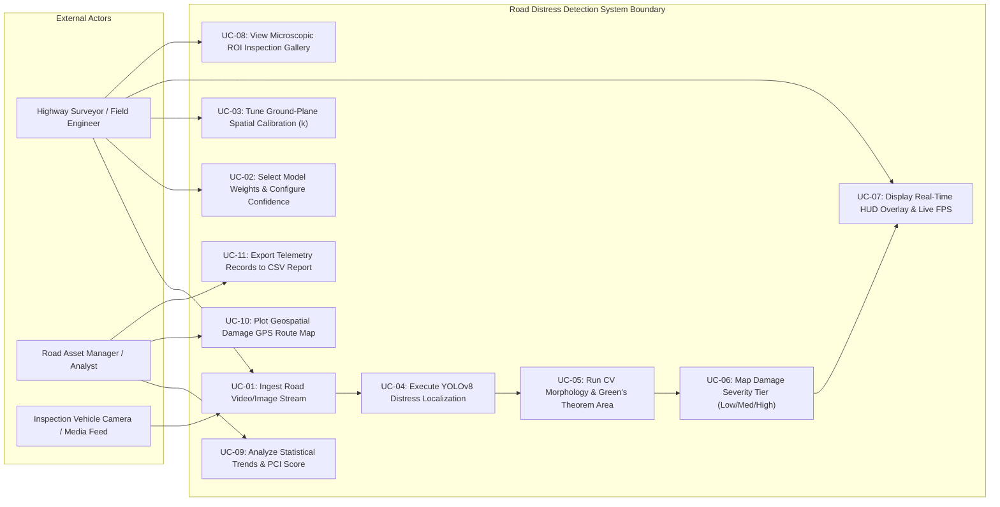
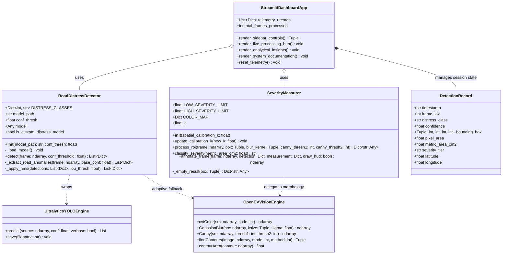
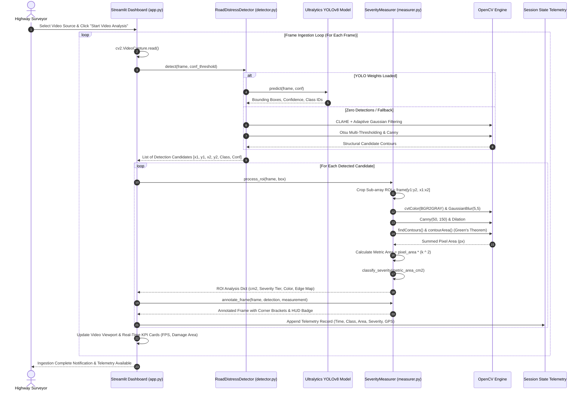
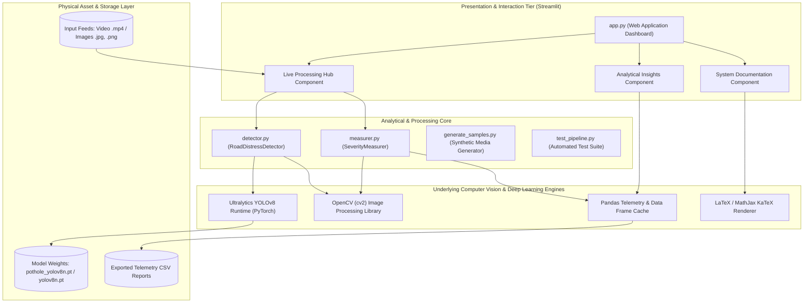
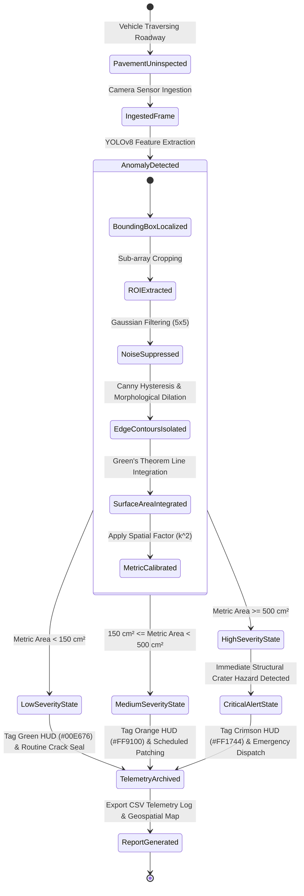
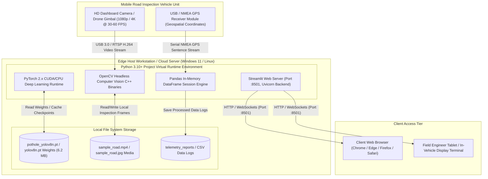

# Comprehensive UML Diagrams Specification
## Project: Automated Road Distress Detection and Severity Mapping Using YOLOv8 and Computer Vision
**Academic Year:** Final-Year (7th/8th Semester) B.Tech / B.E. Computer Science & Engineering Capstone Project  
**Tech Stack:** Python 3.10+, Ultralytics YOLOv8, OpenCV 4.x, Streamlit, Pandas, Green's Theorem Morphology

---

## 1. Use Case Diagram
The Use Case Diagram depicts the functional interactions between primary system actors (Highway Maintenance Surveyor, Systems Analyst) and system automated subsystems.

---

## 2. Class Diagram
The Class Diagram illustrates the object-oriented structure, class attributes, method signatures, data types, and structural relationships.

---

## 3. Sequence Diagram (Frame Ingestion & Severity Mapping)
The Sequence Diagram models the chronological message and control exchanges during live video ingestion and frame processing.

---

## 4. Activity Diagram (Decision Flow & Morphological Pipeline)
The Activity Diagram details the algorithmic control flow, decision branches, and mathematical computation steps.

```mermaid
flowchart TD
    Start(["Start Video/Image Ingestion"]) --> ReadFrame["Read Input Frame via OpenCV"]
    ReadFrame --> CheckValid{"Frame Valid & Non-Empty?"}
    
    CheckValid -- No --> SkipFrame["Log Warning & Advance Stream"]
    SkipFrame --> NextFrame{"More Frames in Stream?"}
    
    CheckValid -- Yes --> YOLOInfer["Run YOLOv8 Model Inference"]
    YOLOInfer --> CheckYOLO{"Detections Found?"}
    
    CheckYOLO -- Yes --> ParseBoxes["Extract Raw Bounding Boxes (x1, y1, x2, y2)"]
    CheckYOLO -- No --> VisionFallback["Execute Adaptive Vision Morphology"]
    
    VisionFallback --> CLAHE["Apply CLAHE Contrast Equalization"]
    CLAHE --> OtsuThresh["Compute Otsu + Adaptive Gaussian Threshold"]
    OtsuThresh --> CannyExtract["Extract High-Gradient Canny Edges"]
    CannyExtract --> DilateBridge["Morphological Dilation (Bridge Fissures)"]
    DilateBridge --> FilterContour["Filter Non-Road & Pebble Noise Contours"]
    FilterContour --> GeometryClassify["Classify Anomaly (Pothole / Alligator / Crack)"]
    GeometryClassify --> ParseBoxes

    ParseBoxes --> ApplyNMS["Apply Non-Maximum Suppression (IoU Threshold = 0.45)"]
    ApplyNMS --> ForEachBox["Iterate Each Isolated Distress ROI"]

    ForEachBox --> CropROI["Dynamically Crop Sub-Array ROI: frame[y1:y2, x1:x2]"]
    CropROI --> GaussianSmooth["2D Gaussian Kernel (Suppress Asphalt Granular Noise)"]
    GaussianSmooth --> EdgeHysteresis["Canny Hysteresis Dual-Thresholding"]
    EdgeHysteresis --> ExtractContour["Extract External Planar Contours"]
    ExtractContour --> GreensIntegral["Compute Contour Area via Green's Theorem: A = 0.5 * sum(x_i * y_{i+1} - x_{i+1} * y_i)"]
    GreensIntegral --> SpatialScale["Apply Ground-Plane Scale: Metric Area = Pixel Area * k^2 (cm^2)"]
    
    SpatialScale --> SeverityCheck{"Evaluate Severity Matrix Thresholds"}
    SeverityCheck -- "Area < 150 cm²" --> LowSev["Classify: Low Severity (Green HUD #00E676)"]
    SeverityCheck -- "150 <= Area < 500 cm²" --> MedSev["Classify: Medium Severity (Orange HUD #FF9100)"]
    SeverityCheck -- "Area >= 500 cm²" --> HighSev["Classify: High Severity (Crimson Red HUD #FF1744)"]

    LowSev --> OverlayHUD["Draw Corner Brackets, Telemetry Badge & Overlay"]
    MedSev --> OverlayHUD
    HighSev --> OverlayHUD

    OverlayHUD --> LogTelemetry["Append Session Telemetry Event (Timestamp, Area, GPS, Class)"]
    LogTelemetry --> MoreBoxes{"More Boxes in Frame?"}
    MoreBoxes -- Yes --> ForEachBox
    MoreBoxes -- No --> RenderView["Render Processed Frame & Update Telemetry KPIs"]

    RenderView --> NextFrame
    NextFrame -- Yes --> ReadFrame
    NextFrame -- No --> End(["End Stream Processing & Display Analytics"])
```

---

## 5. Component Diagram
The Component Diagram shows the high-level structural decomposition into reusable, modular software units.

---

## 6. State Machine Diagram (Road Distress Lifecycle)
The State Machine Diagram traces the state transitions of an identified road pavement anomaly from camera capture to maintenance ticketing.

---

## 7. Deployment Diagram
The Deployment Diagram models the hardware topology and software deployment environment.

